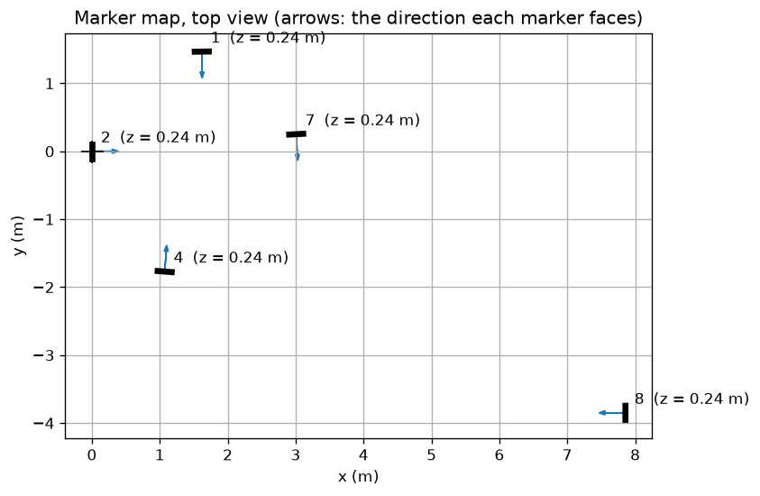

# The Classroom Map

The localization compares what the camera sees with a **map**: where every marker in the room is. The course staff made the map of the classroom for you. This page explains what is in it and how it was made, so that you can judge how far to trust it, and make one yourself for another room.

## The map file

The classroom map is `~/FOR26/ros_ws/src/aruco_localization/config/classroom_map.yaml`. The simulator uses a made-up room with ten markers, `config/sim_room_map.yaml`, in the same format:

```yaml
dictionary: DICT_4X4_50       # the ArUco dictionary of the markers
marker_size: 0.2065           # edge length of the black square, in metres
frame: map
markers:
- id: 1
  position: [1.6178, 1.467, 0.2386]             # centre of the marker, in metres
  orientation: [0.01225, -0.707, 0.7071, 0.00271]  # quaternion [x, y, z, w] of the marker's frame
  yaw_deg: -89.23                               # the direction the marker faces, from the map's x axis
...
```

The marker's frame is the same as in the detector: x to the right of the printed marker, y up, z out of the printed side. `yaw_deg` is only there to make the file easy to read: it is the direction of the marker's z axis in the floor plan.

The `map_node` reads the file, publishes the markers on `/map_markers` and draws them in RViz (dark squares with `marker <id>` above them), and publishes a TF frame `marker_<id>` for each.

## The map frame

| Axis | Direction |
| --- | --- |
| origin | on the floor, straight below the centre of marker 2 |
| z | up |
| x | out of marker 2's wall, into the room |
| y | along that wall, to the right when you stand in the room facing marker 2 |



## How it was made

With a phone, in three steps. The scripts are in [`scripts/`](scripts/) and in [`../Calibration/scripts/`](../Calibration/scripts/).

**1. Calibrate the phone's camera** with a video of the checkerboard, exactly as you calibrated the robot's camera:

```bash
python ../Calibration/scripts/calibrate_camera.py checkerboard.mp4 --every 3 --output phone_intrinsics.yaml
```

**2. Film the room.** Walk around slowly and film the markers. The one rule: **every marker must appear in the same picture as another marker**, at some point, so that the markers are linked to each other. A marker that is only ever seen alone cannot be placed: its position relative to the others is not in the video. Several videos can be used together, so a marker that was missed can be linked with a second short video.

**3. Build the map:**

```bash
python scripts/build_map.py phone_intrinsics.yaml room.mp4 room2.mp4 \
    --marker-size 0.2065 --ids 1 2 4 7 8 --origin 2 --origin-height 0.26 --flatten --same-height \
    --output classroom_map.yaml
```

What the script does (the details are at the top of [`build_map.py`](scripts/build_map.py)):

1. It detects the markers in every second frame of the videos and keeps only the ids that belong to the map (`--ids`). Other robots and stray prints in the room carry markers too.
2. For every frame that sees two or more markers, it computes each marker's pose in the camera frame, as your detector does. Two markers in the same frame give the transform from one marker to the other.
3. It chains those transforms outward from the origin marker to get a first guess of every marker's pose.
4. **Bundle adjustment.** It then adjusts all marker poses and all camera poses together, so that the marker corners, projected through the calibrated camera, land where they were detected in every frame. This uses every sighting at once and spreads the errors evenly, instead of letting them add up along a chain. Sightings that fit far worse than the rest (blur, a wrong detection) are dropped, and the adjustment is repeated.
5. It turns the result into the map frame. Knowing that all markers hang at the same height (`--same-height`) gives a precise "up" direction: the normal of the plane through the marker centres. Which side of that plane is up? The side the camera was on: whoever filmed stood above the markers. `--flatten` then makes every marker exactly vertical (keeping how it is turned on its wall), and `--origin-height` puts the floor at z = 0. The height of marker 2 (0.26 m) was itself measured in the video: the marker, of known size, is a ruler on its own wall, down to the floor line.

The markers do not need to hang upright. In the classroom, markers 1, 4 and 7 are mounted upside down; the map records that, and neither the detector nor the localization cares: the direction a marker faces does not change when it is turned on its wall.

It prints how well everything fits, and the position, direction and tilt of every marker:

```
Bundle adjustment: 506 marker sightings in 253 frames, corner error median 1.28 px, worst 1329.4 px
Dropped 66 sightings that fit badly. Again: 414 sightings in 207 frames, corner error median 0.57 px, worst 29.1 px

Marker   x (m)    y (m)    z (m)   faces (deg)   tilt from vertical (deg)
     1    1.618    1.467    0.250       -89.2              2.1
     2    0.000    0.000    0.260        -0.0              1.7
     4    1.072   -1.771    0.222        85.7              0.5
     7    3.009    0.252    0.211       -86.9              0.8
     8    7.856   -3.850    0.249       180.0              2.7
Flattened: every marker made vertical, all at the average height.
```

The tilts are a good check: the markers really hang vertically, and the bundle adjustment did not know that, yet it finds them all within 3 degrees of vertical. Likewise their heights come out within 5 cm of each other.

## How far to trust it

| Error source | Effect on the map |
| --- | --- |
| The marker size | Every distance in the map scales with it. A size 2 % wrong makes the whole map 2 % too large or too small. |
| The phone's calibration | A few centimetres over the room. Phones also stabilise their videos electronically, which slightly breaks the camera model. |
| Markers seen only far away or in few frames | Their positions are less certain. Marker 8, across the room, was seen in fewer frames, and smaller, than the others. |
| Markers that are moved | The map is wrong for them. If a marker in the classroom is moved, the map must be made again. |

A good check of a map is the localization itself: the `marker_errors_viz` display (see the [Localization guide](../Localization/README.md)) draws, for every detected marker, the distance between where the robot sees it and where the map says it is. A marker that is always off while the others are not is a marker the map has wrong.

## Try it yourself

Make a map of your own: put four or five markers around a room (print them with `cv2.aruco.generateImageMarker`), film them with your phone, and build the map. Measure two distances between markers with a tape measure and compare them with the map.
